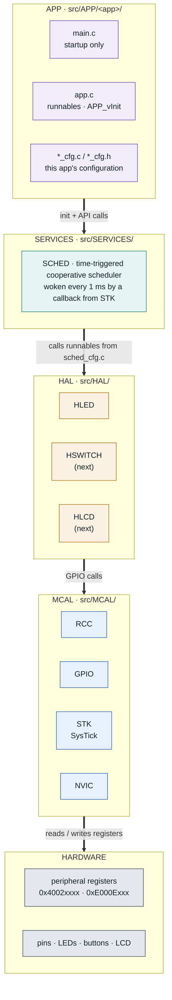
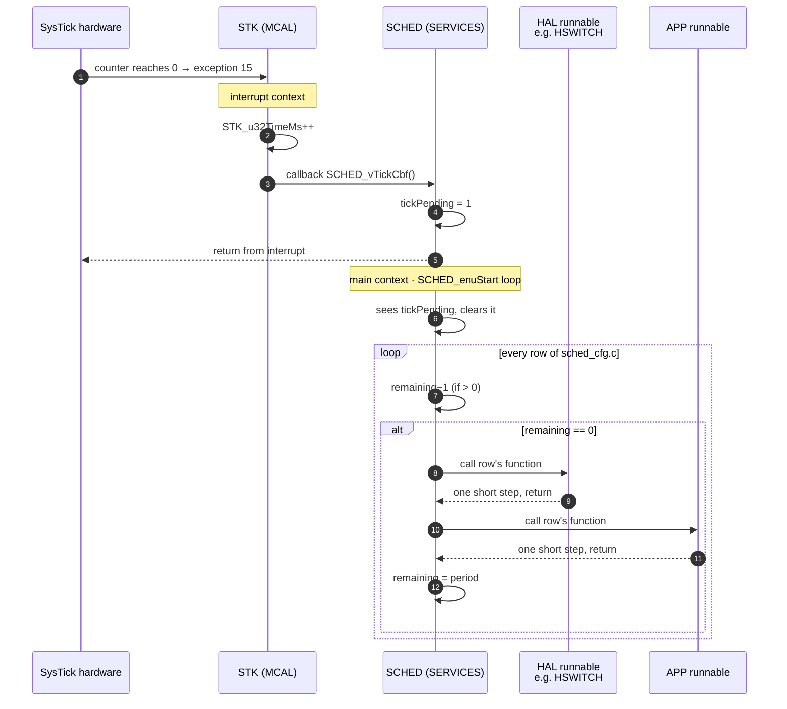
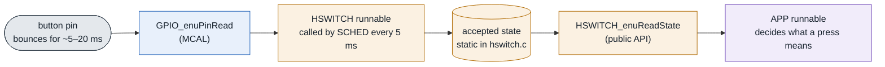
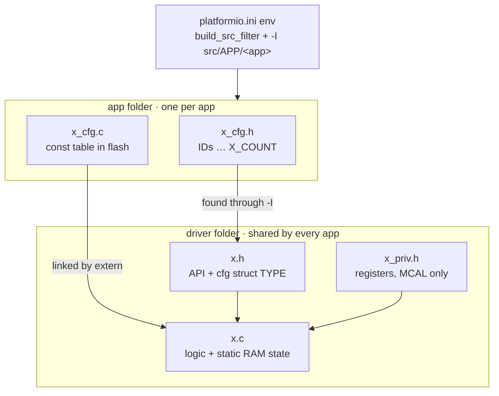

# Architecture

Bare-metal drivers for the **STM32F401CC (Black Pill)**, written from the reference manual (RM0368) and the Cortex-M4 programming manual (PM0214). No HAL library, no CMSIS device headers: every register access lives in this repo.

> GitHub renders the diagrams below directly from the Mermaid source.

---

## 1. Layers

Calls only go **down**. The only way up is a **callback**: a function pointer that a lower layer stores and calls without knowing its name.



Arrows are simplified to one per layer. In detail: the app also calls HAL and MCAL directly (for example HLED and RCC in `APP_vInit`), SCHED calls the **app's** runnables through the same table, and SCHED uses STK for its tick. The two upward paths are callbacks: STK → SCHED (the tick) and SCHED → runnables. `board.h` (BSP) sits beside the stack and only holds pin names per board.

| Layer | Knows | Never does |
|---|---|---|
| **APP** | what the product does | touch a register |
| **SERVICES** | *when* things run | know what a runnable does |
| **HAL** | devices: LED, switch, LCD | touch a register (goes through GPIO) |
| **MCAL** | registers and bit positions | know there is an LED on the pin |

---

## 2. One 1 ms tick



Every runnable must **return quickly**. The scheduler is cooperative: a runnable that blocks freezes all the others.

---

## 3. Where a button press travels



The app never reads the pin and never sees a bounce. It asks HSWITCH for the latest **accepted** state.

---

## 4. Config vs. logic

Each driver is compiled **once per app**. The app folder supplies the configuration through `-I src/APP/<app>`.



| What | Where |
|---|---|
| register address, bit position | `x_priv.h` |
| the *shape* of a config row | `x.h` |
| the *values* (pins, periods) | `x_cfg.c` in the app |
| the list of IDs | `x_cfg.h` in the app |
| runtime state (counters, flags) | `static` in `x.c` (`static volatile` if an ISR shares it) |

---

## 5. Repository layout

```
src/
├── MCAL/        RCC · GPIO · STK · NVIC        registers live only here
├── HAL/         HLED · HSWITCH · HLCD          devices, built on GPIO
├── SERVICES/    SCHED                          when things run
├── BSP/         board.h                        Black Pill / Nucleo pin names
└── APP/<app>/   main.c · app.c · *_cfg.*       behavior + configuration
test/            Unity tests on the PC (UNIT_TEST fake registers)
docs/            this file
```

## 6. Status

| Module | Layer | State |
|---|---|---|
| RCC, GPIO, STK (polling + interrupt), NVIC | MCAL | done |
| HLED | HAL | done |
| SCHED | SERVICES | done |
| HSWITCH | HAL | in progress |
| HLCD (8-bit, then 4-bit, async) | HAL | planned |
| UART | MCAL | planned |
