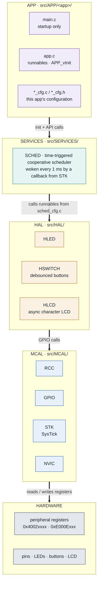
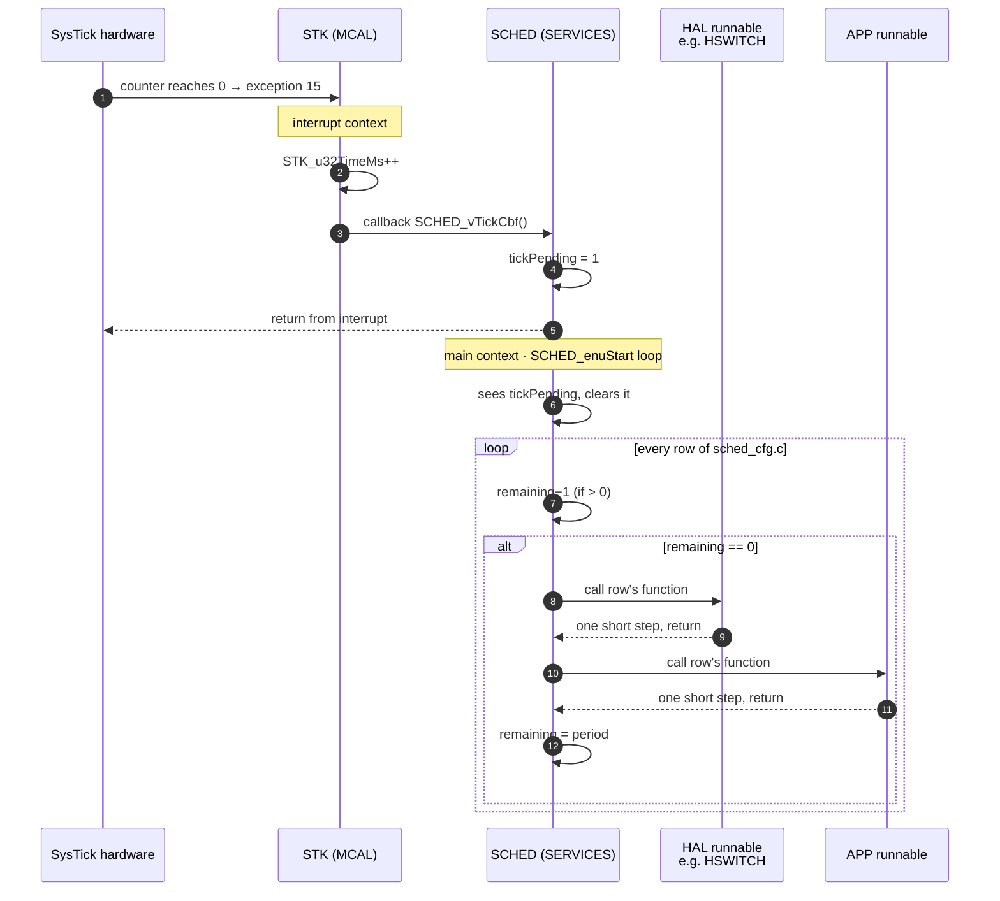
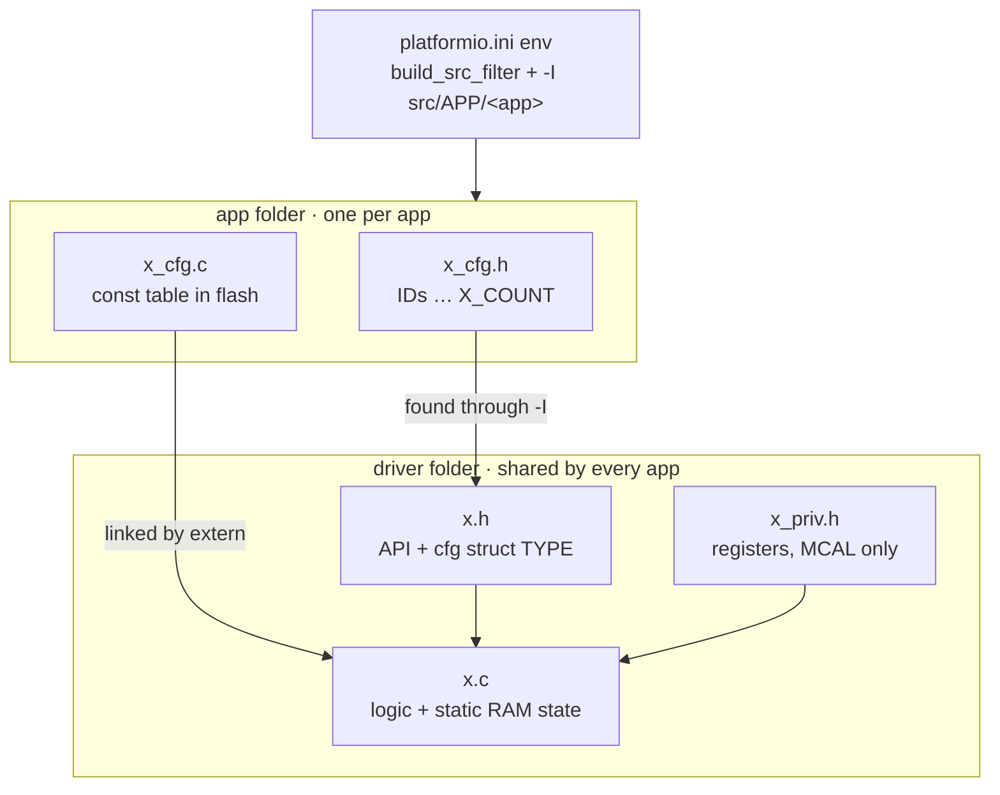
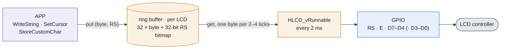
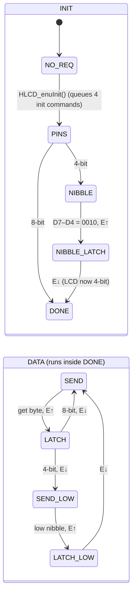

# Architecture

Bare-metal drivers for the **STM32F401CC (Black Pill)**, written from the reference manual (RM0368) and the Cortex-M4 programming manual (PM0214). No HAL library, no CMSIS device headers: every register access lives in this repo.

> GitHub renders the diagrams below directly from the Mermaid source.

---

## 1. Layers

Calls only go **down**. The only way up is a **callback**: a function pointer that a lower layer stores and calls without knowing its name.



Arrows are simplified to one per layer. In detail: the app also calls HAL and MCAL directly (for example HLED and RCC in `APP_vInit`), SCHED calls the **app's** runnables through the same table, and SCHED uses STK for its tick. The two upward paths are callbacks: STK → SCHED (the tick) and SCHED → runnables. `board.h` (BSP) sits beside the stack and only holds pin names per board.

| Layer | Knows | Never does |
|---|---|---|
| **APP** | what the product does | touch a register |
| **SERVICES** | *when* things run | know what a runnable does |
| **HAL** | devices: LED, switch, LCD | touch a register (goes through GPIO) |
| **MCAL** | registers and bit positions | know there is an LED on the pin |

---

## 2. One 1 ms tick



Every runnable must **return quickly**. The scheduler is cooperative: a runnable that blocks freezes all the others.

---

## 3. Where a button press travels


The app never reads the pin and never sees a bounce. It asks HSWITCH for the latest **accepted** state.

---

## 4. Config vs. logic

Each driver is compiled **once per app**. The app folder supplies the configuration through `-I src/APP/<app>`.



| What | Where |
|---|---|
| register address, bit position | `x_priv.h` |
| the *shape* of a config row | `x.h` |
| the *values* (pins, periods) | `x_cfg.c` in the app |
| the list of IDs | `x_cfg.h` in the app |
| runtime state (counters, flags) | `static` in `x.c` (`static volatile` if an ISR shares it) |

---

## 5. HLCD: asynchronous character LCD

Driver for KS0066 / HD44780-compatible LCDs. Supports **several LCDs at once**, **8-bit or 4-bit** bus per LCD, text, cursor moves and **custom characters** (CGRAM). No public function ever waits: the app puts bytes in a queue and returns; one runnable drains it.

### Data path



Commands (cursor moves, CGRAM writes, the init sequence) travel through the **same queue** as characters, so everything reaches the LCD in the order it was requested. Bit *i* of the RS bitmap holds the RS level of slot *i* (0 = command, 1 = data).

### Two state machines per LCD



The lone `0010` nibble switches a 4-bit LCD out of its power-on 8-bit mode; it cannot go through the queue because it has no second half. Everything after it (Function Set, Display ON, Clear, Entry Mode, then app text) is drained from the queue.

### Timing

One E pulse = 2 runnable ticks (E high for a full tick, then low).

| | per byte | 13-byte line (`UP: hh:mm:ss` + cursor) |
|---|---|---|
| 8-bit | 2 ticks × 2 ms = **4 ms** | 52 ms |
| 4-bit | 4 ticks × 2 ms = **8 ms** | 104 ms |

The longest datasheet wait (Clear, 1.53 ms) is shorter than one tick, so no state ever busy-waits. The 30 ms power-on wait is the scheduler's first delay (50 ms).

### Config per LCD (`hlcd_cfg.c`)

| Field | Values |
|---|---|
| `pins[]` | D0–D7, RS, E (D0–D3 unused in 4-bit) |
| `mode` | `HLCD_MODE_8BIT`, `HLCD_MODE_4BIT` |
| `lines`, `font` | 1 / 2 lines, 5×7 / 5×10 |
| `cursor`, `blink`, `entryDirection`, `displayShift` | on / off, increment / decrement |

Switching an app from 8-bit to 4-bit is a one-word change here; app code is untouched.

---

## 6. Repository layout

```
src/
├── MCAL/        RCC · GPIO · STK · NVIC        registers live only here
├── HAL/         HLED · HSWITCH · HLCD          devices, built on GPIO
├── SERVICES/    SCHED                          when things run
├── BSP/         board.h                        Black Pill / Nucleo pin names
└── APP/<app>/   main.c · app.c · *_cfg.*       behavior + configuration
test/            Unity tests on the PC (UNIT_TEST fake registers)
docs/            this file
```

## 7. Status

| Module | Layer | State |
|---|---|---|
| RCC, GPIO, STK (polling + interrupt), NVIC | MCAL | done |
| HLED | HAL | done |
| SCHED | SERVICES | done |
| HSWITCH (shift-register debounce, 4-state machine) | HAL | done |
| HLCD (async queue, multi-LCD, 8/4-bit, CGRAM) | HAL | done |
| HKEYPAD | HAL | next |
| UART | MCAL | planned |

| App (`src/APP/`) | Shows |
|---|---|
| `hswitch_test` | debounced button → LED |
| `hlcd_test` | katakana line, `UP: hh:mm:ss` uptime, CGRAM-animated stick figure |